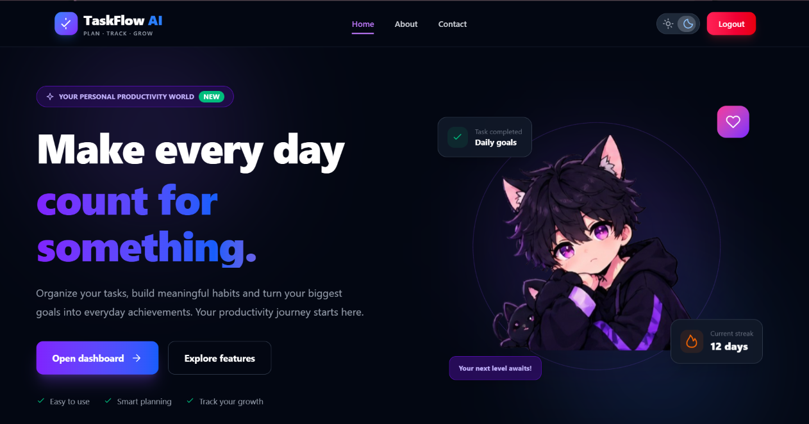
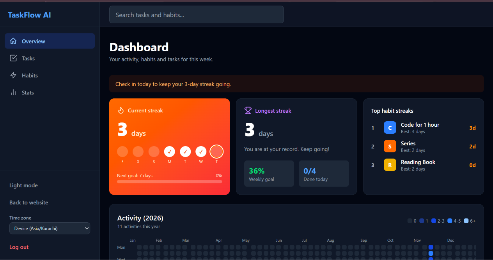
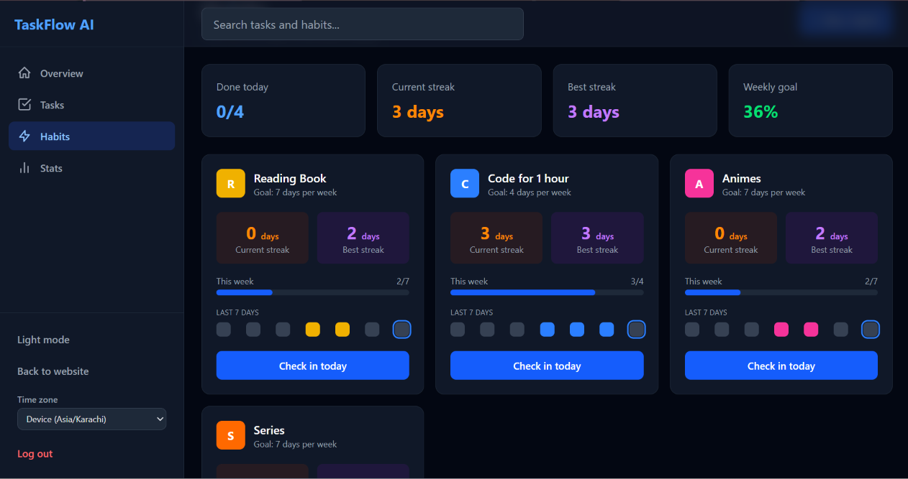
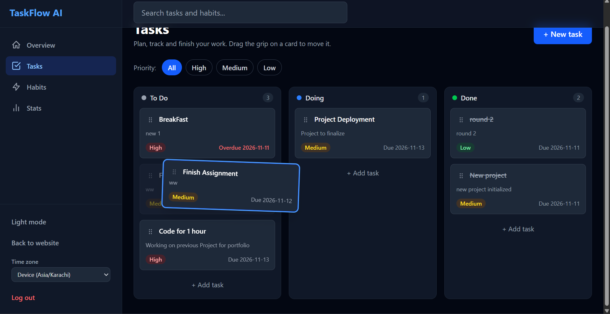
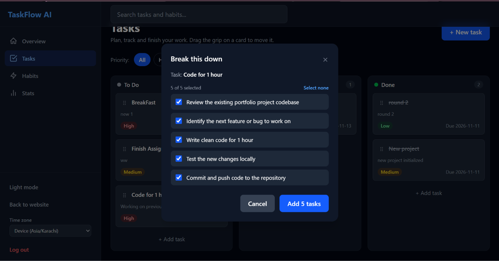
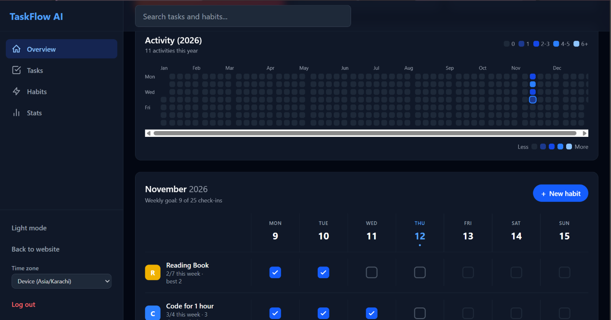

TaskFlow AI

Plan your tasks, build daily habits and keep your streaks alive. An AI helper breaks big tasks into small steps.

Live demo · Report a bug

  

  

  

  

  

  

Features

Tasks

Kanban board with To Do, Doing and Done columns
Drag and drop between columns and inside a column, saved instantly (dnd-kit)
Add, edit and delete tasks with a title, description, priority and due date
Overdue tasks are highlighted
Priority filter on the Tasks page

Habits and streaks

Weekly habit grid with a checkbox for every day
A weekly goal (1 to 7 days) for each habit
One-click Check in today button
Current streak and best streak for every habit
GitHub-style yearly activity heatmap that counts completed tasks and habit check-ins

Stats

Bar chart of tasks completed in the last 7 days (Recharts)
Donut chart of tasks by status
Summary cards: total tasks, completed this week, longest streak, completion rate

AI task breakdown

Click the sparkle icon on a task to get 3 to 6 suggested subtasks
Pick the ones you like, and they are added to your board as new tasks
Loading, error and empty states are handled

Everything else

Sign up and log in with email and password or Google (Firebase Authentication)
Global search for tasks and habits, with the matching text highlighted
Light and dark mode that remembers your choice
Responsive layout for phones, tablets and desktops
Toast messages, loading skeletons and friendly empty states
Every user sees only their own data

Tech stack
Area	Tools
Frontend	React, Vite, Tailwind CSS v4, React Router v7
Backend as a service	Firebase Authentication and Cloud Firestore
Drag and drop	dnd-kit
Charts	Recharts
Notifications	react-hot-toast
AI	Google Gemini API, called from a serverless function
Hosting	Vercel (site and serverless function)

How it works
Page or component  >  hook (useTasks, useHabits)  >  service (Firebase calls)  >  Firestore
Real-time data. Firestore listeners (onSnapshot) keep the board, habits and charts in sync. A change in one tab appears in another without a refresh.
Dates are plain text in the form YYYY-MM-DD, so a day never shifts between time zones. Task completion time is stored as a timestamp and placed on the right day when drawing the heatmap and charts.
Streaks are calculated from the list of checked days. They are not stored, so they can never get out of sync.
Drag and drop updates the screen immediately, then saves the new status and order in one batch write. If saving fails, the card goes back to where it was.
The AI key is never in the browser. The app sends the task text and the user's Firebase login token to /api/breakdown. The serverless function checks the token, limits the input size, allows 10 requests per user every 10 minutes, calls Gemini, and returns only a clean list of short strings.
Security rules in Firestore allow a signed-in user to read and write only the documents that belong to them, and they validate the fields.

Notes and limits
AI suggestions use Google's free Gemini tier. It has low rate limits, and free-tier requests may be used by Google to improve its products, so avoid putting private information into tasks that you send to the AI.
Google sign-in only works on domains listed in the Firebase authorized domains.
Roadmap
A demo mode so visitors can try the app without signing up
Recurring tasks and reminders
Subtasks stored inside a task
Shared boards for small teams

Author

Hajra Khattak · <a href="https://github.com/Hajra-Khattak/">Github </a>